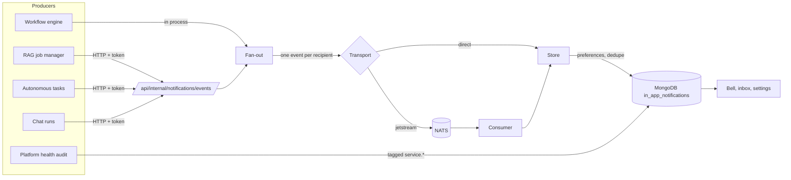
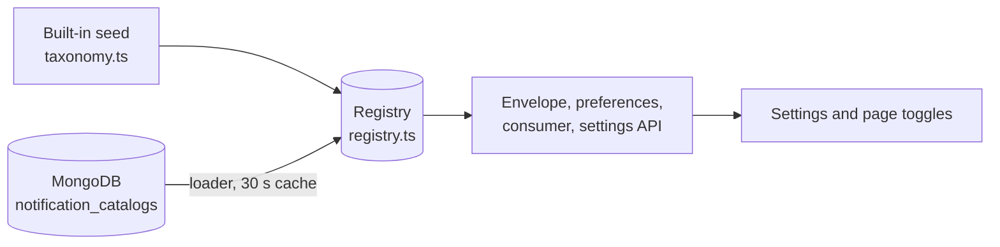

# Event Notifications

Users choose which events notify them. Ingestion, workflow, and agent runs publish events. The UI server applies each person's preferences and writes their notification inbox.

Tracked in epic #2934. Architecture target: discussion #2937.

## How an event flows



- Producers never know about users or preferences.
- A producer failure never reaches the job that produced the event.
- Each recipient's preferences are checked before an inbox entry is written. With JetStream the check runs in the consumer, after the event is queued.

## Events

| Event | Fires when | Default |
|---|---|---|
| `ingestion.completed` | Ingestion job finishes, including with errors | On |
| `ingestion.failed` | Ingestion job fails or is terminated | On |
| `ingestion.started` | Ingestion job begins | Off |
| `workflow.completed` | All steps finish | On |
| `workflow.failed` | A step aborts the run, authorization is denied, or the run exceeds its time limit | On |
| `workflow.requires_input` | A step pauses for human input | On |
| `workflow.started` | A run begins | Off |
| `agent.completed` | An autonomous task succeeds, or a chat run lasting at least `NOTIFICATION_CHAT_MIN_SECONDS` finishes | On |
| `agent.failed` | An autonomous task or chat run fails | On |
| `agent.started` | Reserved. No producer emits it yet | Off |
| `service.degraded` | Platform health opens an incident | On |
| `service.recovered` | Platform health confirms recovery | On |

Not implemented: `agent.requires_approval`, `integration.*`, and `ingestion.progress`. No lifecycle hook exists for them today.

These 12 events are the built-in seed of the [registry](#event-registry). The seed is in `ui/src/lib/notifications/taxonomy.ts`.

## Event registry

Event types and categories are entries in a registry, not a TypeScript union. Installed apps add their own without a code change.



Each entry has:

| Field | Meaning |
|---|---|
| `type` | `<namespace>.<name>` |
| `category` | Category id |
| `label`, `description` | Copy for the settings UI |
| `defaultEnabled` | Applies when the user set nothing |
| `severity` | `info`, `success`, `warning`, or `error` |
| `schemaVersion` | Version of the event's `data` payload. Informational, not enforced |
| `source` | `builtin`, or the app id |

Rules for an app catalog:

- The namespace is the app id, a lowercase slug. Every event type is `<app id>.<name>`, with `name` in `[a-z0-9_]`.
- `ingestion`, `workflow`, `agent`, `service`, and `platform` are reserved. A catalog that uses one is rejected.
- Each app gets one category. Its id is the app id and its label comes from the catalog. App events never appear under a built-in category.
- Registering an app again replaces all of its entries at once. This is how a version bump works.
- A catalog that fails validation changes nothing. The app keeps its previous entries.
- An event type the registry does not know is rejected at publish, in preference updates, and in Send test.

### Catalog document

One document per app in the `notification_catalogs` collection. Nothing writes it yet, so insert it directly. A unique index on `app_id` is recommended.

```json
{
  "app_id": "example-app",
  "version": "1.0.0",
  "category": { "label": "Example App", "description": "Updates from Example App." },
  "events": [
    {
      "type": "example-app.sync_failed",
      "label": "Sync failed",
      "description": "A sync failed.",
      "default_enabled": true,
      "severity": "error",
      "schema_version": 1
    }
  ]
}
```

- The UI server reads the collection at most every 30 seconds per process (`ensureNotificationCatalogsLoaded`). `refreshNotificationCatalogs()` forces a read.
- A removed document unregisters its app. An invalid document is skipped and logged.
- If MongoDB cannot be read, the registry keeps what it has.
- A new or changed catalog reaches each replica within about 30 seconds.
- Apps cannot use the shared-inbox path. It is reserved for platform health events.

- Each server process keeps its own copy of the registry and refreshes it from the database every 30 seconds.
- An event with an unknown type forces one immediate refresh before it is rejected, so an app installed seconds ago works without a restart. Forced refreshes are limited to one per 5 seconds, so unknown types cannot turn into database load.
- Without that refresh a producer would get a permanent `400` and the JetStream consumer would discard the message.

## Who is notified

| Source | Recipients |
|---|---|
| Workflow | The run owner |
| Ingestion | The datasource creator and owner, anyone who created or edited a job for it, and org admins |
| Autonomous task | The task owner |
| Chat run | The user who sent the message |
| Service events | Org admins |

- "Org admins" are direct `admin` members of the organization in OpenFGA. Admins who hold the role only through a team are not expanded.
- Service accounts have no inbox and are skipped.
- A request is capped at 50 listed recipients and 200 after expansion.

## Preferences

- Order of precedence: the event setting, then the category setting, then the default.
- Settings are stored per user, in `user_settings.notification_preferences`. Only overrides are stored.
- `null` in an update removes an override, so the event returns to its default.
- Turning off an event stops new notifications. It never changes the job, ingestion, or workflow.
- Preferences are enforced on the server when the event is written. The UI does not filter.
- Preference edits are guarded by a revision number. Two tabs or replicas editing at once both keep their changes. If the document keeps changing, the API answers `409` and the client should reload and retry.
- Service events are stored once for all admins, so they are filtered when the inbox is read.

The settings page and the page toggles read labels, descriptions, and categories from the preferences API, which reads the registry. App categories appear automatically.

Manage them in **Settings → Notifications**, or from the toggle on the workflows, ingestion, and agent pages. Both write the same stored preference.

## Transports

| Mode | Setting | Behavior |
|---|---|---|
| Direct | `NOTIFICATIONS_TRANSPORT=direct` (default) | Written in process. No broker. Lost if the process dies mid-write. |
| JetStream | `NOTIFICATIONS_TRANSPORT=jetstream` | Published to a durable stream. A consumer in the UI server writes the inbox. |

- NATS is optional and off by default.
- With JetStream selected and NATS unreachable, publishing reports `failed`. It does not fall back to direct.
- Stream `CAIPE_EVENTS`: file storage, 7-day retention, 2-minute duplicate window.
- Durable consumer `caipe-notifications`: explicit acks, 5 delivery attempts, 5-second retry delay after a storage failure. Malformed messages are dropped.
- Subjects are `caipe.events.v1.<event type>`. They never contain user IDs, and browsers never connect to NATS.
- Delivery is at least once. The inbox ignores repeats using a deterministic key, so duplicates are harmless.

## Duplicates, retries, and replicas

- Inbox key: `type : resource type : resource id : attempt id : recipient`.
- A retried workflow or job has a new attempt ID, so it creates a new notification. A redelivery of the same attempt does not.
- A unique index on `event_key` makes this safe across replicas.
- The event `id` is not part of the inbox key. It only feeds the JetStream duplicate id (`id:attempt_id:recipient subject`).
- A redelivered attempt in direct mode is reported as `delivered`, with no second entry.
- Contract: [notification-ingress.openapi.yaml](../ui/notification-ingress.openapi.yaml).

## Failure behavior

| Situation | Result |
|---|---|
| NATS down at startup | The app starts. The consumer retries every 5 seconds. |
| NATS down while publishing | Publish reports `failed` and the job is unaffected. |
| Consumer crashes mid-write | The message is redelivered. The key prevents a duplicate. |
| Preference changed while an event is in flight | The latest preference wins, checked when the event is written. |
| Recipient matches no user record | Skipped and counted in `skipped`. |
| Subject and email name different users, or only one of the two matches a user | Rejected and counted in `rejected`. |
| OpenFGA unavailable | Explicit recipients still receive. Org admins are skipped. |

Known limit: a process that stops between finishing a job and sending its event can lose that event. An outbox would close this gap and is not built.

## Security

- The internal endpoint needs `NOTIFICATIONS_INTERNAL_TOKEN` as a bearer token and answers `503` without one. Tokens are compared in constant time.
- The credential is verified into a **publisher identity** (`ui/src/lib/notifications/publisher*.ts`). The identity, not the request body, decides what a caller may do.
  - `401`: missing or wrong credential. `503`: no credential configured. `403`: authenticated, but not permitted.
  - A publisher is limited to listed event namespaces, may or may not notify org admins, and has a recipient cap.
- Today the shared token maps to one **first-party** publisher with full authority. Treat the token holder as fully trusted, and keep external apps outside it.
- Per-app credentials are not built. They would be verified in `authenticatePublisher` and return an `app` identity, so the route and the permission checks do not change. Issuing them belongs to the app install flow.
- Recipients are resolved from the UI server's own user records. Both the subject and the email are taken from that one record, never from the request.
- A request that names a subject and an email belonging to different users is rejected for that recipient. A pair where only one half matches a user is also rejected. A reference that matches no user is skipped. The response reports the two counts separately as `rejected` and `skipped`.
- Notification text is generic. Prompts, step errors, documents, and tool output are never included.
- Links must be relative paths. External URLs are rejected.
- "Send test" only ever notifies the caller, and is limited to 10 per minute.

## Retention

- Event notifications expire after `NOTIFICATION_RETENTION_DAYS` (default 90) through a MongoDB TTL index on `expires_at`. `0` keeps them forever.
- Platform health incidents carry no expiry, so open incidents are never deleted.

## Configuration

| Variable | Where | Default |
|---|---|---|
| `NOTIFICATION_EVENTS_ENABLED` | UI and producers | `true`. `false` makes every producer a no-op. |
| `NOTIFICATIONS_INTERNAL_TOKEN` | UI and producers | Unset. Producers send nothing until set. |
| `NOTIFICATIONS_INTERNAL_URL` | Producers | `http://caipe-ui:3000` |
| `NOTIFICATIONS_TRANSPORT` | UI | `direct` |
| `NATS_URL`, `NATS_TOKEN` | UI | `nats://nats:4222`, unset |
| `NOTIFICATION_RETENTION_DAYS` | UI | `90` |
| `NOTIFICATION_CHAT_MIN_SECONDS` | dynamic-agents | `30` |

- Docker Compose: set the variables in `.env`. Add `nats` to `COMPOSE_PROFILES` for a local JetStream server.
- Helm: set non-secret values under `caipe-ui.config`. Reference secrets with `caipe-ui.notifications.internalToken.secretName` and `caipe-ui.notifications.natsToken.secretName`. The Helm chart does not install a NATS server.

## Publishing a new event

- Built-in event: add it to the seed in `taxonomy.ts` with its category, copy, default, and severity.
- App event: add it to the app's catalog document. No code change.
- From the UI server, call `publishNotificationRequest` with the event and its recipients.
- From another service, POST the event request (envelope plus `recipients` and/or `include_org_admins`) to `/api/internal/notifications/events`. See the [API reference](../ui/api-reference.md#internal-service-routes).
- Only add an event that actually fires. Keep the summary free of prompts, errors, and document content.

## Local testing

- Run `NOTIFICATIONS_MONGO_TEST=1 MONGODB_URI=... npx jest notifications-mongo` for the database tests.
- Run `NATS_INTEGRATION_URL=nats://localhost:4222 npx jest notifications-jetstream` against a local server started with `docker run -p 4222:4222 nats:2.10-alpine -js`.
- In Settings, use **Send test** on any event to see it arrive in the bell.
